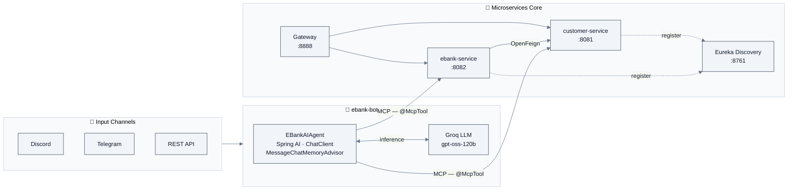

<div align="center">

# E-Bank · Distributed Banking System with Applied Generative AI

**Microservices Architecture · LLM Agent · Model Context Protocol · Multi-channel Deployment**


</div>

---

## Overview

**E-Bank** is a fully distributed banking system built from scratch on a **microservices architecture**, extended with a **production-ready AI agent** capable of querying live services in natural language.

The project is structured in two self-contained layers:

| Layer | Focus | Key Technologies |
|:---:|---|---|
| **1 — Microservices Core** | Distributed services, inter-service communication, fault tolerance, API routing | Spring Boot, Spring Cloud, OpenFeign, Resilience4J, Eureka, Gateway |
| **2 — Applied Generative AI** | LLM agent grounded on live microservices data via MCP, multi-channel deployment | Spring AI, Groq, Model Context Protocol, Discord, Telegram |

> The AI agent does not operate on static data — it calls real service methods annotated with `@McpTool`, reads and writes live banking data, and maintains per-user conversation memory across sessions.

---

## Architecture



**Data flow:** User message → Channel → AI Agent → Groq LLM decides which tool to call → `@McpTool` method on a live microservice → real database read/write → response back through the channel.

---

## Applied Generative AI — Key Design Decisions

This section details the AI architecture choices, relevant to anyone evaluating AI/data engineering skills.

### 1 · Model Context Protocol (MCP) as the AI–Data Bridge

Rather than hardcoding prompts with business logic, the services expose their data access methods directly to the LLM through the **Model Context Protocol**. Any method annotated with `@McpTool` becomes a callable tool for the agent.

```java
// customer-service — CustomerService.java
@McpTool(description = "Get all customers")
public List<Customer> getAllCustomers() { ... }

@McpTool(description = "Save Customer")
public void saveCustomerByAIAgent(
    @McpToolParam(description = "Customer to save (name,email)") CustomerDTO customer) { ... }
```

```java
// ebank-service — EBankService.java
@McpTool(description = "Get a bank account by its id")
public BankAccount getBankAccountById(
    @McpToolParam(description = "The id of the bank account") UUID id) { ... }

@McpTool(description = "Save a bank account")
public BankAccount saveBankAccountByAIAgent(
    @McpToolParam(description = "The Bank Account (type,customerId,balance)") BankAccountDTO dto) { ... }
```

The LLM receives tool descriptions at runtime, reasons about which to invoke, and executes them — with no additional orchestration code needed.

### 2 · Stateful Conversation Memory

Each user session maintains its own isolated conversation history via `MessageChatMemoryAdvisor`. The conversation ID is derived from the platform user ID (Discord user ID, Telegram chat ID, etc.), making memory portable across restarts without a shared session store.

```java
this.chatClient = chatClient
    .defaultAdvisors(MessageChatMemoryAdvisor.builder(chatMemory).build())
    .defaultTools(tools)
    .build();
```

### 3 · Multi-channel, Single Agent

One `EBankAIAgent` instance is reused across all channels. Each channel adapter (Discord, Telegram, REST) translates the platform event into a `Prompt` and a `conversationId`, keeping the AI layer fully decoupled from the transport layer.

```java
// Discord adapter — one line of integration
String response = ebankAIAgent.chat(new Prompt(query), event.getAuthor().getId());
```

---

## Microservices Core — Engineering Highlights

### Service Discovery · Eureka

All services self-register on startup. The Gateway resolves routes dynamically by service name — no hardcoded IPs, no manual configuration per environment.

### Fault Tolerance · Resilience4J Circuit Breaker

Inter-service calls from `ebank-service` to `customer-service` are wrapped with Resilience4J. If `customer-service` becomes unavailable, the circuit opens, preventing cascading failures across the system.

### API Gateway · Spring Cloud Gateway

A single entry point on port `8888` routes all incoming traffic. Route discovery is dynamic via Eureka, meaning adding a new microservice requires zero changes to the gateway configuration.

### Inter-Service Communication · OpenFeign

`ebank-service` consumes `customer-service` via a declarative Feign client — typed, load-balanced, and Eureka-aware:

```java
@FeignClient(name = "customer-service")
public interface CustomerRestClient {
    @GetMapping("/api/customers/{id}")
    Customer getCustomerById(@PathVariable Long id);
}
```

---

## Technology Stack

| Domain | Technology | Role |
|---|---|---|
| Language | Java 21 | Record types, pattern matching, virtual threads |
| Framework | Spring Boot 4.1.1 | Application foundation for all services |
| AI Framework | Spring AI 2.0.1 | ChatClient, advisors, MCP tooling |
| LLM Provider | Groq (`gpt-oss-120b`) | Fast inference for the conversational agent |
| AI Protocol | Model Context Protocol | Structured tool exposure from services to LLM |
| Service Discovery | Eureka (Spring Cloud Netflix) | Dynamic service registration and lookup |
| API Gateway | Spring Cloud Gateway | Unified entry point, dynamic routing |
| Inter-Service Comms | OpenFeign | Declarative, typed HTTP client |
| Fault Tolerance | Resilience4J | Circuit breaker on inter-service calls |
| Persistence | Spring Data JPA + H2 | ORM layer, in-memory DB for development |
| API Docs | springdoc-openapi (Swagger UI) | Auto-generated REST documentation |
| Channels | JDA (Discord) · Telegram Bots API | Multi-platform bot interfaces |
| Build | Maven (multi-module) | Unified build for all services |

---

## Project Structure

```
ebank-microservices-project/
│
├── discovery-service/          # Eureka Server — service registry (:8761)
│
├── gateway-service/            # Spring Cloud Gateway — API entry point (:8888)
│
├── customer-service/           # Customer domain microservice (:8081)
│   ├── entities/               # JPA entity — Customer
│   ├── repository/             # Spring Data repository
│   ├── service/                # Business layer + @McpTool endpoints
│   ├── dto/                    # Data Transfer Objects
│   └── web/                    # REST controller (Swagger documented)
│
├── ebank-service/              # Banking domain microservice (:8082)
│   ├── entities/               # JPA entity — BankAccount
│   ├── repository/             # Spring Data repository
│   ├── feign/                  # OpenFeign client → customer-service
│   ├── services/               # Business layer + @McpTool endpoints
│   ├── dto/                    # Data Transfer Objects
│   └── web/                    # REST controller (Swagger documented)
│
├── ebank-bot/                  # AI Agent service (:8080)
│   ├── agents/                 # EBankAIAgent — ChatClient + memory + MCP tools
│   ├── discord/                # Discord channel adapter
│   ├── telegram/               # Telegram channel adapter
│   └── web/                    # REST channel adapter
│
└── docs/
    └── diagrams/               # PlantUML class & use-case diagrams
```

---

## Getting Started

### Prerequisites

- Java 21+
- Maven 3.9+
- A [Groq API key](https://console.groq.com/) (free tier available)
- Discord bot token and/or Telegram bot token *(optional — REST channel works without them)*

### Run Order

Services must start in this order to allow proper registration:

```bash
# 1 — Start the service registry first
cd discovery-service && ./mvnw spring-boot:run

# 2 — Start business microservices (order between them doesn't matter)
cd customer-service && ./mvnw spring-boot:run
cd ebank-service    && ./mvnw spring-boot:run

# 3 — Start the API gateway
cd gateway-service  && ./mvnw spring-boot:run

# 4 — Start the AI agent
cd ebank-bot        && ./mvnw spring-boot:run
```

### Service Endpoints

| Service | URL | Description |
|---|---|---|
| Eureka Dashboard | http://localhost:8761 | Registered services overview |
| Customer API | http://localhost:8888/customer-service/swagger-ui.html | Customer REST API docs |
| EBank API | http://localhost:8888/ebank-service/swagger-ui.html | Banking REST API docs |
| AI Agent REST | http://localhost:8080/api/chat | Chat with the AI agent via HTTP |

---

## What This Project Demonstrates

**For a Software Engineering role:**
- Design and implementation of a distributed system from scratch
- Applied cloud-native patterns: service discovery, API gateway, circuit breaker, declarative HTTP clients
- Clean separation of concerns across independently deployable services
- Multi-module Maven project management

**For a Data Engineering role:**
- Structured data flow across services via typed REST contracts
- Persistence layer design with JPA in a distributed context
- Data access abstraction exposed as AI-callable tools (MCP)

**For an Applied AI / Generative AI role:**
- Integration of a production LLM (Groq) within a Spring Boot application
- Agentic system design: the LLM autonomously selects and calls tools based on user intent
- Stateful, per-user conversation memory management
- Grounding an LLM on live, structured, domain-specific data — not static documents
- Multi-channel deployment of a single AI agent (Discord, Telegram, REST)

---

<div align="center">
<sub>Built with Java 21 · Spring Boot · Spring AI · Spring Cloud · Groq · MCP</sub>
</div>
